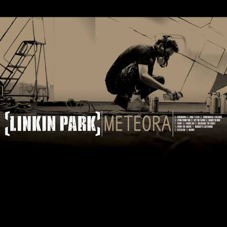
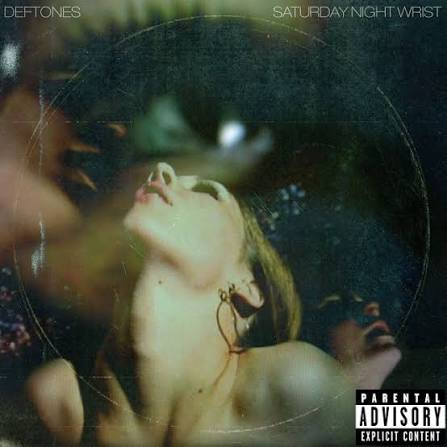
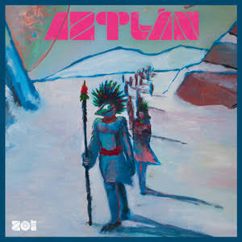
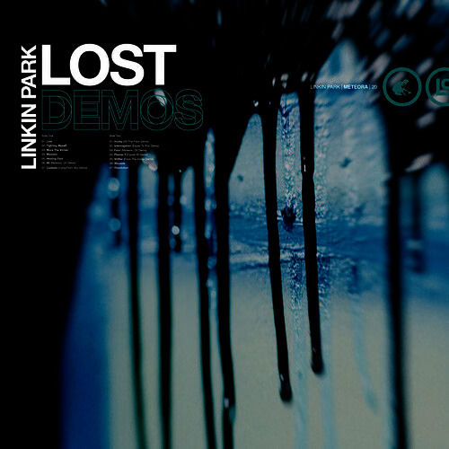

<h1 align="center">Hola, soy Francisco</h1>

  

  Estudiante de desarrollo de software enfocado en aplicaciones web y móviles. 
  Me gusta construir proyectos, aprender tecnologías nuevas y mejorar un poco cada día.

---

<h2 align="center">Stack tecnológico</h2>

<table align="center">
  <tr>
    <td align="right"><b>Lenguajes</b></td>
    <td>
      
      
      
      
    </td>
  </tr>
  <tr>
    <td align="right"><b>Front-End</b></td>
    <td>
      
      
      
    </td>
  </tr>
  <tr>
    <td align="right"><b>Móvil</b></td>
    <td>
      
      
    </td>
  </tr>
  <tr>
    <td align="right"><b>Back-End</b></td>
    <td>
      
      
    </td>
  </tr>
  <tr>
    <td align="right"><b>Bases de datos</b></td>
    <td>
      
      
    </td>
  </tr>
  <tr>
    <td align="right"><b>Herramientas</b></td>
    <td>
      
      
      
    </td>
  </tr>
</table>

---

<h2 align="center">Música</h2>

  Rock y Nu-Metal

<table align="center">
  <tr>
    <th align="center">Linkin Park</th>
    <th align="center">Deftones</th>
    <th align="center">Enjambre</th>
    <th align="center">Zoé</th>
  </tr>
  <tr>
    <td align="center">
       
      Meteora
    </td>
    <td align="center">
       
      Saturday Night Wrist
    </td>
    <td align="center">
       
      Daños de Luz
    </td>
    <td align="center">
       
      Aztlan
    </td>
  </tr>
  <tr>
    <td align="center">
       
      Lost Demos
    </td>
    <td align="center">
       
      Private Music
    </td>
    <td align="center">
       
      Proaño
    </td>
    <td align="center">
       
      Memo Rex Commander y el Corazón Atómico de la Vía Láctea
    </td>
  </tr>
</table>

---

  <a href="https://github.com/JFFA25" target="_blank" rel="noopener noreferrer">github.com/JFFA25</a>

